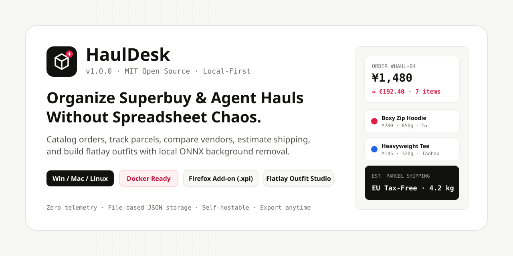

<div align="center">
  

  <h1>HaulDesk (Italiano)</h1>
  <p>
    <strong>Catalogo ordini local-first, gestione multi-vendor, stima spedizioni e studio outfit flatlay per i tuoi haul Superbuy e agent.</strong>
  </p>

  <p>
    <a href="README.md">English (README.md)</a> · <strong>Italiano</strong> · <a href="DEPLOYMENT.md">Guida Server &amp; Docker</a> · <a href="CONTRIBUTING.md">Contribuisci</a>
  </p>
</div>

---

> **Nota sulla Lingua:** Questa pagina è una traduzione in italiano della documentazione. L'interfaccia dell'applicazione (`v1.0.0`) è in **inglese** (lingua predefinita); il supporto per ulteriori lingue è pianificato per le versioni future.

## Cos'è HaulDesk

Quando un haul cresce tra album Yupoo, link Taobao/Weidian, tassi di cambio CNY variabili, peso dei pacchi e tracking sparsi, i fogli Excel diventano scomodi in fretta.

**HaulDesk** ti offre un'unica app locale o self-hosted, veloce e senza account:

- **Zero telemetria, zero cloud obbligatori:** tutti i dati restano in un singolo file JSON (`hauldesk-db.json`) sul tuo PC o server.
- **Drag & Drop + `Ctrl+V`:** trascina o incolla foto direttamente dal browser, gestisci gallerie multi-foto e scegli la cover principale.
- **Dall'acquisto all'armadio:** gestisci ordini aperti e conclusi, tasso di conversione CNY personalizzabile, valutazioni 1–5 stelle, outfit flatlay e scontorno automatico locale.

---

## Funzionalità Principali

- **Area Ordini & Valute:** Crea ordini, passa tra ordini attivi e conclusi, modifica il tasso di conversione CNY globale o per singolo ordine e visualizza i prezzi in `EUR`, `USD`, `GBP`, `JPY`, `INR` o `CNY`.
- **Salva per Dopo & Cestino:** Parcheggia gli articoli in wishlist fuori dagli ordini attivi e ripristina eventuali ordini o prodotti eliminati dal Cestino.
- **Rubrica Vendor:** Raggruppamento automatico per venditore con spesa totale, conteggio articoli e media stelle calcolata dalle recensioni dei tuoi ordini conclusi.
- **Armadio & Build Outfit (Flatlay Studio):** Assegna valutazioni 1–5 stelle ai capi arrivati, componi outfit trascinando e ridimensionando i capi sul canvas e rimuovi lo sfondo localmente con `onnxruntime-node` + `sharp` (`u2netp.onnx`).
- **Stima Spedizione & Tracking Live:** Stima del peso per categoria merceologica (con pesi personalizzabili e rimozione scatole scarpe), preventivi stimati delle linee Superbuy, sincronizzazione eventi pubblici Cainiao e tappe manuali.
- **Ricevute Stampabili, CSV & Backup JSON:** Stampa ricevute dettagliate, esporta CSV pronti per Excel (UTF-8 BOM) ed esegui backup/ripristino completi in JSON (compatibile anche con vecchi export v0).
- **Estensione Firefox (`HaulDesk Quick Add`):** Popup e barra laterale a 4 step per catalogare articoli in tempo reale mentre navighi su Yupoo/Taobao/Superbuy.

---

## Piattaforme & Agent Supportati

| Piattaforma | Supporto | Note |
| --- | --- | --- |
| **Yupoo** | Completo | Rilevamento piattaforma + estrazione automatica suggerimento vendor da `<vendor>.yupoo.com`. |
| **Taobao / Tmall / `tb.cn`** | Completo | Rilevamento URL e catalogazione rapida con drag & drop / incolla foto. |
| **Weidian & 1688** | Completo | Rilevamento URL, rubrica venditori e gestione prezzi in CNY. |
| **Superbuy** | Completo | Rilevamento URL, stima linee spedizione dedicate e collegamento al calcolatore spedizioni Superbuy. |
| **Altri Agent (CSSBuy, Sugargoo, Mulebuy...)** | Generico / Manuale | Utilizzabile per catalogare qualsiasi link e stimare il peso per categoria; i preset tariffari attuali sono tarati su Superbuy. |

---

## Avvio Rapido

### 1. App Desktop Standalone (Windows, macOS, Linux — Nessun Node.js richiesto)
Scarica il pacchetto per il tuo sistema operativo dalla pagina **[Releases](https://github.com/DDT2943/HaulDesk/releases)**:
- **Windows x64:** `.exe` (Setup installer o versione Portable)
- **macOS (Apple Silicon & Intel):** `.dmg` o `.zip` (`arm64` / `x64`)
- **Linux x64:** `.AppImage` o `.deb`

Tutti i dati vengono salvati nella cartella dati utente del sistema operativo (`userData/data`). Al primo utilizzo dello scontorno AI su Windows, Linux e Apple Silicon (`arm64`) viene scaricato automaticamente il modello `u2netp.onnx` (~4,4 MB, Apache-2.0, verificato con SHA-256); su Mac Intel (`x64`), dove `onnxruntime-node` non fornisce binari ufficiali, l'app usa automaticamente il fallback locale su canvas.

### 2. Docker Compose (Self-Hosting)
```bash
git clone https://github.com/DDT2943/HaulDesk.git
cd HaulDesk
cp .env.example .env
docker compose up -d --build
```
Apri `http://127.0.0.1:3000`. Se aggiorni un server già esistente dietro reverse proxy (es. porta `3003`), consulta **[DEPLOYMENT.md](DEPLOYMENT.md)**.

### 3. Da Sorgente (Node.js 20+ / 22+)
```bash
git clone https://github.com/DDT2943/HaulDesk.git
cd HaulDesk
npm install --legacy-peer-deps
cp .env.example .env
npm run dev
```

---

## Estensione Firefox (`hauldesk-quickadd.xpi`)

1. Scarica `hauldesk-quickadd.xpi` dalle [Releases](https://github.com/DDT2943/HaulDesk/releases), dall'endpoint `/hauldesk-quickadd.xpi` del tuo server HaulDesk (es. `http://localhost:3000/hauldesk-quickadd.xpi`), oppure compilala localmente con `npm run pack:extension`.
2. Su Firefox apri `about:debugging#/runtime/this-firefox` -> **Carica componente aggiuntivo temporaneo** e seleziona `hauldesk-quickadd.xpi`.
3. Usa il pulsante della barra laterale per tenere l'estensione aperta mentre navighi. Le richieste verso `localhost` funzionano subito; per domini personalizzati Firefox chiederà il permesso solo per quel dominio specifico.

---

## Roadmap

- [ ] **Ulteriori lingue per l'interfaccia** (in aggiunta alla lingua predefinita inglese della `v1.0.0`)
- [ ] **Nuove funzionalità dal feedback della community** — eventuali proposte e miglioramenti suggeriti dagli utenti verranno valutati e integrati nei prossimi aggiornamenti

---

## Trasparenza & Supporto Opzionale

HaulDesk nasce come progetto sviluppato in modo iterativo con supporto AI ("vibecoded") e poi revisionato con test automatici, hardening di sicurezza (protezione SSRF multi-hop, CORS selettivo, permessi minimi) e build multipiattaforma.

È e resterà al 100% gratuito e open source sotto **Licenza MIT**, senza pubblicità, telemetria o link affiliati. Se ti fa risparmiare tempo con i tuoi haul e vuoi offrire un supporto simbolico:

- **Ko-fi:** https://ko-fi.com/ddt2943

---

## Licenza
Rilasciato sotto **[Licenza MIT](LICENSE)**. Tutte le dipendenze e attribuzioni sono elencate in **[THIRD_PARTY_NOTICES.md](THIRD_PARTY_NOTICES.md)**.
