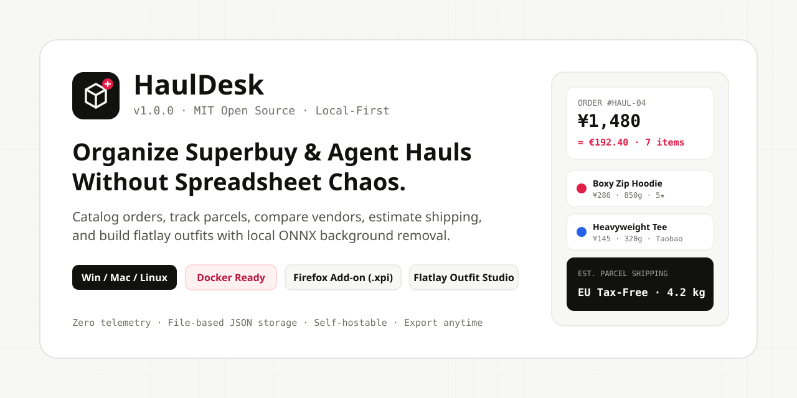

<div align="center">
  

  <h1>HaulDesk</h1>
  <p>
    <strong>Local-first order catalog, multi-vendor organizer, shipping estimator, and flatlay outfit studio for Superbuy &amp; shopping agent hauls.</strong>
  </p>

  <p>
    <a href="https://github.com/DDT2943/HaulDesk/releases"></a>
    <a href="LICENSE"></a>
    <a href=".github/workflows/ci.yml"></a>
    
    
  </p>

  <p>
    <strong>English</strong> · <a href="README.it.md">Italiano (README.it.md)</a> · <a href="DEPLOYMENT.md">Server Deployment</a> · <a href="CONTRIBUTING.md">Contributing</a>
  </p>
</div>

---

## Why HaulDesk?

Spreadsheets break the moment you start juggling 15 items across Yupoo albums, Taobao/Weidian links, changing CNY conversion rates, shoebox weight tradeoffs, and parcel tracking updates.

**HaulDesk** replaces messy sheets with a fast, visual workspace that stays completely on your own machine or self-hosted server:

- **Zero accounts & zero telemetry:** Your haul data stays in a portable JSON file (`hauldesk-db.json`) under your control.
- **Visual cataloging:** Drag-and-drop or paste (`Ctrl+V`) product photos directly from browser tabs, store multiple gallery photos per item, and pick a cover photo.
- **Built for real hauls:** Track open vs. concluded orders, custom CNY exchange rates, vendor averages, parcel weights, and saved drafts.

> **Language Note:** English is currently the default application language. Additional language support is planned for future releases. (Italian documentation is available in [`README.it.md`](README.it.md).)

---

## Key Features

| Module | What It Does |
| --- | --- |
| **Orders Workspace** | Manage open and concluded hauls, adjust per-order or global CNY exchange rates, filter across 10 clothing/accessory categories, switch display currency (`EUR`, `USD`, `GBP`, `JPY`, `INR`, `CNY`), and run bulk actions. |
| **Saved for Later & Trash** | Park links/photos you are considering for your next haul and move them into active orders later; recover accidentally deleted orders or items from Trash. |
| **Vendors Directory** | Automatically groups items by seller, highlights spend/item counts per store, and computes average seller star ratings from your concluded reviews. |
| **Wardrobe & Flatlay Studio** | Rate delivered pieces from 1–5 stars, assemble custom flatlay outfits on an interactive drag-and-drop canvas, and strip backgrounds locally using `onnxruntime-node` + `sharp` (`u2netp.onnx`). |
| **Shipping Estimator & Tracking** | Estimates total parcel weight by garment category (with customizable weights and shoebox removal toggle), compares estimated Superbuy line quotes, queries live Cainiao tracking events, and stores manual milestones. |
| **Printable Receipts, CSV & JSON Backups** | Print/export itemized order receipts, export UTF-8 BOM spreadsheets (`.csv`), and back up/restore complete hauls (`.json`, including legacy schema migration). |
| **Firefox Companion Add-on** | Included `.xpi` popup & persistent sidebar wizard for capturing photos, prices, vendors, and links in 4 quick steps while browsing Yupoo/Taobao/Superbuy. |

---

## Platform & Agent Compatibility

| Integration | Status | Notes |
| --- | --- | --- |
| **Yupoo** | Supported | Auto-detects platform and automatically extracts vendor name hints from `<vendor>.yupoo.com` / `<vendor>.x.yupoo.com` URLs. |
| **Taobao / Tmall / `tb.cn`** | Supported | Platform detection, link storage, drag-and-drop photo capture (manual input — no brittle HTML scraping). |
| **Weidian & 1688** | Supported | Platform detection, link storage, vendor tracking, and category cataloging. |
| **Superbuy** | Supported | Platform detection, built-in estimated shipping line rates, volumetric calculator, and deep link to Superbuy's freight calculator. |
| **Other Agents (CSSBuy, Sugargoo, Mulebuy, etc.)** | Manual / Generic | Works smoothly for cataloging any link, vendor, price, and custom category weight; shipping line presets currently model Superbuy rates. |
| **Courier Tracking** | Supported | Queries Cainiao public JSON gateway (`global.cainiao.com`) when available, plus 1-click links to 17TRACK / ParcelsApp and manual milestones. |

---

## Quick Start

### Option 1 — Standalone Desktop App (Recommended, No Node.js Required)

Download the installer for your OS from the **[Releases](https://github.com/DDT2943/HaulDesk/releases)** page:

- **Windows (x64):** `HaulDesk-1.0.0-win-x64-setup.exe` (installer) or `HaulDesk-1.0.0-win-x64-portable.exe`
- **macOS (Apple Silicon & Intel):** `HaulDesk-1.0.0-mac-arm64.dmg` / `HaulDesk-1.0.0-mac-x64.dmg` (or `.zip`)
- **Linux (x64):** `HaulDesk-1.0.0-linux-x86_64.AppImage` or `HaulDesk-1.0.0-linux-amd64.deb`

The desktop app bundles Chromium, Express, Sharp, and ONNX Runtime, binds strictly to `127.0.0.1` on an ephemeral port, and stores your data inside your OS user-data directory.

> **First Background-Removal Run:** On the very first outfit cutout on Windows, Linux, or Apple Silicon (`arm64`), HaulDesk downloads the lightweight `u2netp.onnx` model (~4.4 MB, Apache-2.0, SHA-256 verified) into `${DATA_DIR}/models/`. You can disable this completely with `DISABLE_AI_BG_REMOVAL=true`. On Intel Macs (`x64`), `onnxruntime-node` has no upstream prebuilt binary, so HaulDesk automatically falls back to its built-in client-side edge-gradient cutout without crashing.

---

### Option 2 — Docker Compose (Self-Hosted / Home Server)

```bash
git clone https://github.com/DDT2943/HaulDesk.git
cd HaulDesk
cp .env.example .env
docker compose up -d --build
```

Open `http://127.0.0.1:3000`. All haul data and cached models persist in `./data/`.

- Upgrading an existing reverse-proxy server (e.g., Nginx on port `3003`)? See **[DEPLOYMENT.md](DEPLOYMENT.md)** for copy-paste backup, upgrade, and rollback commands.
- **Important:** HaulDesk has no built-in login screen. Always keep it bound to `127.0.0.1` behind an authenticated reverse proxy (Authelia, Cloudflare Access, Tailscale, or Basic Auth) if exposed beyond localhost.

---

### Option 3 — Run from Source (Node.js 20+ / 22+)

```bash
git clone https://github.com/DDT2943/HaulDesk.git
cd HaulDesk
npm install --legacy-peer-deps
cp .env.example .env
npm run dev
```

For production builds from source:

```bash
npm run build
npm run pack:extension
NODE_ENV=production npm start
```

---

## Firefox Companion Extension (`HaulDesk Quick Add`)

HaulDesk includes a dedicated Firefox add-on (`hauldesk-quickadd.xpi`) with popup and persistent sidebar modes:

1. Download `hauldesk-quickadd.xpi` from [Releases](https://github.com/DDT2943/HaulDesk/releases), fetch it from `/hauldesk-quickadd.xpi` on your running HaulDesk server (e.g. `http://localhost:3000/hauldesk-quickadd.xpi`), or build it locally with `npm run pack:extension`.
2. In Firefox, open `about:debugging#/runtime/this-firefox` -> **Load Temporary Add-on...** and select `hauldesk-quickadd.xpi` (or `firefox-extension/manifest.json` after `npm run build:extension`) — or install a signed XPI when published to AMO.
3. Click the HaulDesk toolbar icon (or pop it out into Firefox's **Sidebar** so it stays pinned while browsing Yupoo/Taobao!).
4. By default it connects to `http://localhost:3000`. If you self-host on a custom domain, open extension **Settings** and Firefox will ask permission only for that specific origin.

---

## Configuration (`.env`)

| Variable | Default | Description |
| --- | --- | --- |
| `PORT` | `3000` | HTTP server port (`0` selects an ephemeral port) |
| `HOST` | `0.0.0.0` | Network interface to bind (`127.0.0.1` for local/proxy-only) |
| `HAULDESK_HOST_PORT` | `3000` | Host port mapped by `docker-compose.yml` (`127.0.0.1:${HAULDESK_HOST_PORT}:3000`) |
| `DATA_DIR` | `./data` | Directory storing `hauldesk-db.json` and `models/u2netp.onnx` |
| `APP_URL` | `http://localhost:3000` | Primary public origin permitted by CORS |
| `ALLOWED_ORIGINS` | `""` | Comma-separated extra origins permitted by CORS |
| `DISABLE_AI_BG_REMOVAL` | `false` | Set `"true"` to skip ONNX segmentation downloads and use fast client cutout |
| `BG_REMOVAL_MODEL_PATH` | `""` | Custom local filesystem path to a pre-downloaded `u2netp.onnx` file |

---

## Security & Architecture Highlights

- **Multi-hop SSRF Defense:** Image proxy (`/api/proxy-image`) and background removal (`/api/remove-background`) use manual redirects (`maxRedirects: 4`), resolve DNS on every hop, block loopback/RFC-1918/CGNAT/link-local metadata IPs, detect redirect loops, require `image/*` MIME types, and cap payloads at 12 MB.
- **Scoped CORS:** Permits same-origin, localhost, configured `APP_URL`/`ALLOWED_ORIGINS`, and browser extension origins (`moz-extension://`, `chrome-extension://`) while rejecting untrusted cross-site mutating requests (`403`).
- **Clean Runtime Dependency Tree:** `npm audit --omit=dev` reports **0 vulnerabilities** (`express`, `dotenv`, `onnxruntime-node`, `sharp`).

See **[SECURITY.md](SECURITY.md)** for full details and vulnerability reporting.

---

## Roadmap

- [ ] **Additional UI languages** (expanding beyond the default English `v1.0.0` interface)
- [ ] **Community-driven features** — additional enhancements and integrations proposed through user feedback will be evaluated and added in future updates

---

## Support & Development Transparency

HaulDesk was built iteratively with AI-assisted coding ("vibecoded") and hardened with automated TypeScript checks, unit tests, security audits, and cross-platform packaging workflows. It is 100% free, open-source under the MIT License, and contains no ads, tracking, or affiliate links.

If HaulDesk saved you time on your hauls and you'd like to leave an optional tip:

- **Ko-fi:** https://ko-fi.com/ddt2943

---

## License & Attribution

- Licensed under the **[MIT License](LICENSE)**.
- Third-party runtime, font, icon, and model attributions are listed in **[THIRD_PARTY_NOTICES.md](THIRD_PARTY_NOTICES.md)**.
